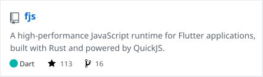
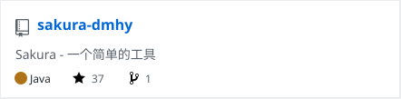
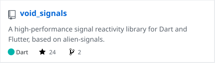
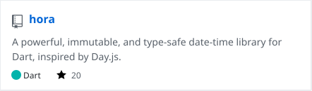
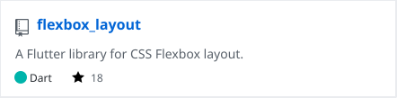
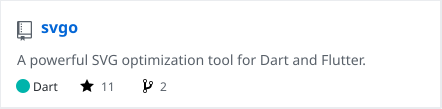
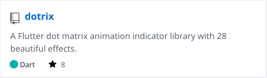
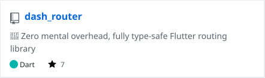

# ✨ iota9star — turning iotas into stars

**Full Stack Developer** 🧑‍💻 · **Rust & Java Backend** 🦀☕ · **Product Mindset** 🎯

Building digital experiences across the whole stack — from high-performance backends to elegant frontends, one tiny commit at a time 👋

## 👨‍💻 About Me

An *iota* is the smallest letter in the Greek alphabet — and the smallest spark of a star ✨ Everything I build starts there: small, sharp, well-typed pieces that compose into something much bigger.  
I'm a full-stack engineer who cares as much about how a product **feels** as how it **runs** — Rust and Java services that stay fast under pressure, Flutter / React / Vue interfaces that get out of the user's way.  
Types that hold, tests that catch, APIs that read like prose — that's the bar.  
By day I ship Flutter packages with the [fluttercandies](https://github.com/fluttercandies) crew 🍬 — by night I'm parsing anime RSS feeds 🌸, decoding on-chain signals ⛓️, and teaching AI agents to write cleaner code than I do 🤖.

## 🎯 What I Do

- 🦀 **Backend engineering** — high-performance services in Rust (Axum) and Java (Spring), microservices that hold up under real load
- 📱 **Cross-platform frontends** — Flutter for mobile magic, React / Vue for the web, Kotlin for native Android
- 🤖 **AI-powered development** — code assistants, agents, and quality-first automation woven into the dev loop
- ⛓️ **Web3 exploration** — BTC, EVM contracts, and the Internet Computer
- 🧩 **Open source** — building and maintaining a whole shelf of Flutter packages at [fluttercandies](https://github.com/fluttercandies)

## 🛠️ Tech Stack

**🦀 Languages**  
    

**⚙️ Backend**  
   

**🎨 Frontend**  
   

**🤖 AI & ⛓️ Web3**  
🤖 AI agents & assistants · 🧠 AI-powered dev workflows ·   

## 📊 Quick Stats

- ⭐ **1.8K+ stars** across 24 featured repositories
- 🌸 Flagship **mikan_flutter** carries **1.4K+ ⭐** all by itself
- 🦀 **[fjs](https://github.com/fluttercandies/fjs)** is the fastest riser — **114 ⭐** and climbing
- 🍬 **20 packages** contributed to the [fluttercandies](https://github.com/fluttercandies) organization
- 🔥 Watch the 3D city above keep growing, commit by commit

  
  

## 🔥 Featured Projects

**1.8K+ ⭐ across 24 projects — sorted by popularity.** Every card is clickable 👇

<table>
<tr>
<td align="center"></td>
<td align="center"></td>
</tr>
<tr>
<td align="center"></td>
<td align="center"></td>
</tr>
<tr>
<td align="center"></td>
<td align="center"></td>
</tr>
<tr>
<td align="center"></td>
<td align="center"></td>
</tr>
<tr>
<td align="center"></td>
<td align="center"></td>
</tr>
<tr>
<td align="center"></td>
<td align="center"></td>
</tr>
<tr>
<td align="center"></td>
<td align="center"></td>
</tr>
<tr>
<td align="center"></td>
<td align="center"></td>
</tr>
<tr>
<td align="center"></td>
<td align="center"></td>
</tr>
<tr>
<td align="center"></td>
<td align="center"></td>
</tr>
<tr>
<td align="center"></td>
<td align="center"></td>
</tr>
<tr>
<td align="center"></td>
<td align="center"></td>
</tr>
</table>

## 🏆 Highlights

- 🌸 **[mikan_flutter](https://github.com/iota9star/mikan_flutter)** — 1.4K+ ⭐ Flutter client for the Mikan Project: bangumi tracking, RSS subscriptions, and a UI people genuinely enjoy using
- 🦀 **[fluttercandies/fjs](https://github.com/fluttercandies/fjs)** — a high-performance JavaScript runtime inside Flutter, built on Rust and QuickJS (114 ⭐)
- 🍬 **fluttercandies core contributor** — 20 packages covering caching ([kache](https://github.com/fluttercandies/kache)), rate limiting ([f_limit](https://github.com/fluttercandies/f_limit)), navigation ([dash_router](https://github.com/fluttercandies/dash_router)), state ([hora](https://github.com/fluttercandies/hora)), TV focus ([dpad](https://github.com/fluttercandies/dpad)) and more
- 🌸 **Anime data tooling** — [sakura-dmhy](https://github.com/iota9star/sakura-dmhy) and [kisssub](https://github.com/iota9star/kisssub) keep the resources flowing
- ⛓️ **[void_signals](https://github.com/void-signals/void_signals)** — turning on-chain noise into signals worth reading

## 💡 Quote of the Moment

> 🎐 *“认真的思索，真诚的明辨是非，有这种态度，大概可算是善良吧。”*
> — *Wang Xiaobo (王小波), The Silent Majority (沉默的大多数)* · via [Hitokoto](https://hitokoto.cn)

*To think seriously and sincerely tell right from wrong — that alone might be what goodness is.* Most of engineering is honestly telling bug from feature 😉 and doing it kindly.

## 💭 Philosophy

- 🧱 **Performance is a feature** — fast software is kind software
- 🎯 **Think in iotas** — small sharp pieces that compose into big pictures ✨
- 🤝 **Quality over cleverness** — types, tests, and docs beat unreadable one-liners
- 🌱 **Build in the open** — learn publicly, share generously, star generously ⭐

## 📧 Connect

- ✉️ Email: [iota9star@gmail.com](mailto:iota9star@gmail.com)
- 🐦 X: [@iota9star](https://x.com/iota9star)
- ⛏️ Juejin: [Blog](https://juejin.cn/user/1591748568562829)
- 🐙 GitHub: [@iota9star](https://github.com/iota9star)

Thanks for stopping by — have a stellar day 🌟
