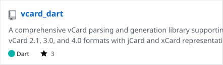

**Full Stack Developer · Rust & Java Backend · Product Mindset** ✨

## 👨‍💻 About Me

Hey, I'm **iota9star** — a full-stack engineer who has been turning coffee into commits since August 2016 ☕📅, currently at **102 public repos** and showing no signs of stopping.
My home turf is the **Rust ↔ Flutter boundary** 🦀📱: FFI bridges, rendering-adjacent widgets, and the kind of glue code that has to be *both* fast and boring.
Server-side I reach for **Axum** and **Spring** ☕ when p99 latency and horizontal scale actually matter — microservices tuned by measurement, not vibes. 📏
Client-side I ship with **Flutter**, **React** ⚛️, and **Vue** 💚, because a feature isn't finished until it feels good in someone's hand.
I work **with AI agents in the loop** 🤖 every day — they draft, I architect, and the quality gates stay firmly on. ✅
Off the clock: seasonal anime 🌸, BTC / EVM / IC rabbit holes ⛓️, and benchmarking things nobody asked me to benchmark. 🔬

## 🎯 What I Do

- 🦀 **Performance-first backends** — Axum & Spring services where p99 is a feature, not an afterthought
- 📱 **Cross-platform clients** — Flutter, Android, React, Vue: one product, every screen
- 🔌 **Rust × Dart bridges** — FFI layers that make native speed a first-class Flutter citizen
- 🍬 **Open source stewardship** — 20 packages maintained in the fluttercandies ecosystem
- 🤖 **AI-augmented workflows** — code assistants and agents, with humans holding the review pen ✍️
- ⛓️ **Web3 experiments** — BTC, EVM contracts, and the Internet Computer 🌐

## 🛠️ Tech Stack

**Languages** 💻
    

**Backend** ⚙️
   

**Frontend** 🎨
   

**Currently exploring** 🔭
🤖 agentic dev loops · ⛓️ BTC / EVM / IC · 🌸 anime data pipelines · ✅ quality-gated automation

## 📊 Quick Stats

⭐ **1,823 stars** across 📦 **24 featured repos** · 🥇 flagship at **1.4K+ ⭐** · 👥 **283 followers** · 🗃️ **102 public repos** · 🍬 **20 packages** under fluttercandies · 📅 **10+ years** of public building

## 🔥 Featured Projects

Sorted by stars — fresh numbers straight from the GitHub API. 👇

## 🏆 Highlights

- 🥇 **mikan_flutter** — 1.4K★ flagship: a Flutter anime client that fans actually daily-drive 🌸
- 🍬 **20 fluttercandies packages** — widgets, routing, caching, parsing, layout, and more
- 🦀 **Rust core, everywhere** — engines and bridges built once, running on every platform
- ⭐ **1,823 stars** earned across the ecosystem, one useful PR at a time 💚
- 📅 **10+ years** of open source — first commit Aug 2016, latest commit probably today ⏱️

## 💭 Philosophy

> *"Measure first, optimize second — the profiler knows more than I do."* 📏  
> *"An API is a promise; break it and users break up with you."* 🤝  
> *"Let agents write the boilerplate, so humans can afford to think."* 🤖  
> *"Software is only done when it feels good in the hand."* ✨

## 🌸 Beyond the Terminal

- 🎬 **Seasonal anime tracking** — my own scrapers feed my own watchlist, naturally
- ⛓️ **Web3 deep dives** — BTC, EVM, and IC experiments purely for the fun of it
- 🔬 **Recreational benchmarking** — yes, I benchmark my keyboard's latency too ⌨️
- ☕ **Coffee-driven development** — the original just-in-time compiler

## 💡 Quote of the Day

> 人性一个最特别的弱点就是：在意别人如何看待自己。  
> *"One of the strangest weaknesses of human nature is caring how others see you."* 🌿  
> — Arthur Schopenhauer 叔本华

## 📧 Connect

- ✉️ Email: [iota9star](mailto:iota9star@gmail.com)
- 🐦 X: [@iota9star](https://x.com/iota9star)
- 📝 Juejin: [Blog](https://juejin.cn/user/1591748568562829)
- 💬 GitHub: [@iota9star](https://github.com/iota9star)

