### 👨‍💻 About Me

Hi, I'm **iota9star** 🌟 — named after the tiniest star in the sky, building things that shine anyway ✨  
I'm a full stack developer who genuinely likes the whole stack: 🦀 Rust and ☕ Java backends that stay calm under pressure, and 📱 Flutter · React · Vue frontends where every frame feels deliberate 🎨  
I sweat the invisible details — error states that help instead of scold 🧯, empty screens with personality 🫧, and latency nobody ever notices ⏱️  
By night I sketch reactive state graphs ⚡, dig into BTC / EVM / IC ⛓️, and coach AI agents 🤖 until their pull requests are a pleasure to review  
I ship open source candy 🍬 under [fluttercandies](https://github.com/fluttercandies) and write about the journey on [Juejin](https://juejin.cn/user/1591748568562829) ✍️

### 🎯 What I Do

- 🦀 **High-Performance Backends** — Rust (Axum) & Java (Spring) microservices built for throughput, resilience, and honest observability
- 📱 **Cross-Platform Products** — Flutter, React, Vue & Android experiences that feel at home on every screen
- 🍬 **Open Source Packaging** — 20+ Flutter packages authored, documented, and maintained for the community
- ⚡ **Reactive Systems R&D** — fine-grained signals and state graphs with zero-boilerplate ergonomics
- 🤖 **AI-Native Workflows** — assistants and agents woven into daily development, always behind a quality-first bar
- ⛓️ **Web3 Exploration** — BTC fundamentals, EVM contracts, and Internet Computer canisters

### 🛠️ Tech Stack

**💻 Languages**  
    

**⚙️ Backend**  
   

**🎨 Frontend**  
   

**🤖 AI & ⛓️ Web3**  
    

### 📊 Quick Stats

    

  
  

### 🔥 Featured Projects

🌟 Ranked by community love — tap any card to open the source 🔍

[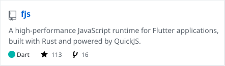](https://github.com/fluttercandies/fjs)
[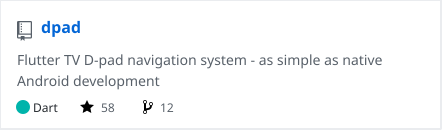](https://github.com/fluttercandies/dpad)

[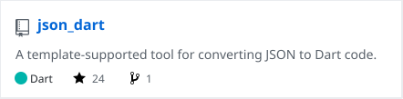](https://github.com/fluttercandies/json_dart)
[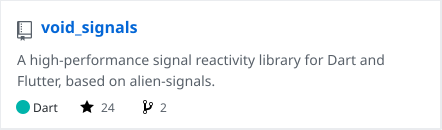](https://github.com/void-signals/void_signals)
[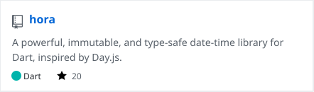](https://github.com/fluttercandies/hora)
[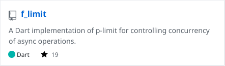](https://github.com/fluttercandies/f_limit)
[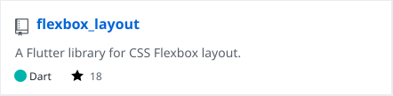](https://github.com/fluttercandies/flexbox_layout)
[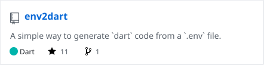](https://github.com/fluttercandies/env2dart)
[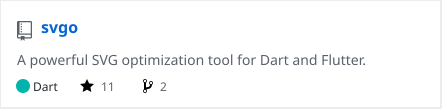](https://github.com/fluttercandies/svgo)
[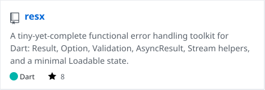](https://github.com/fluttercandies/resx)
[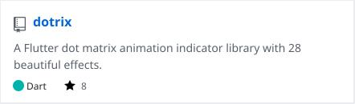](https://github.com/fluttercandies/dotrix)

[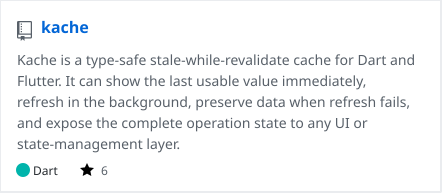](https://github.com/fluttercandies/kache)
[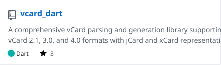](https://github.com/fluttercandies/vcard_dart)

### 🏆 Highlights

- 🥇 [mikan_flutter](https://github.com/iota9star/mikan_flutter) — **1.4k ⭐** a Bangumi & anime resource tracking client the community asked for, by name
- 🥈 [fjs](https://github.com/fluttercandies/fjs) — **114 ⭐** JavaScript at native speed for Flutter apps
- 🥉 [dpad](https://github.com/fluttercandies/dpad) — **60 ⭐** gamepad-friendly focus navigation for Flutter interfaces
- 🌸 [sakura-dmhy](https://github.com/iota9star/sakura-dmhy) — **37 ⭐** & [kisssub](https://github.com/iota9star/kisssub) — **35 ⭐** resource search clients for the anime community
- ⚡ [void_signals](https://github.com/void-signals/void_signals) — **24 ⭐** high-performance fine-grained signals for Dart & Flutter, built on alien-signals ideas
- 🍬 **20+ packages** under the [fluttercandies](https://github.com/fluttercandies) umbrella — JSON, routing, layouts, concurrency limits, caching, images, and more
- 🧭 Rustacean by conviction, Java craftsman by trade, product person by instinct

### 💡 Quote of the Moment

> 云母屏风烛影深，长河渐落晓星沉。  
> *"Candlelight dims behind the mica screen; the long river sinks, the dawn stars fade."*  
> — 李商隐《嫦娥》· Li Shangyin, "Chang'e" — via hitokoto 💠  
> A dawn star fading into morning — fitting, for someone named after the smallest one 🌠

### 🌍 Contribution Landscape

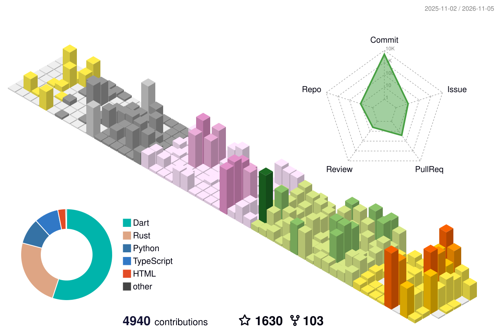

### 💭 Philosophy

- 🎯 Build the product, not just the code — the experience is the destination
- 🧱 Small commits, honest reviews, zero broken windows
- 🤖 Automate the boring, handcraft the essential
- 🌱 Leave every codebase easier to understand than you found it
- 🧭 Measure twice, ship once — then iterate fast 🚀
- 📚 Stay curious — today's weekend hack becomes tomorrow's production stack ✨

### 📧 Connect with Me

  

⭐️ From [iota9star](https://github.com/iota9star)
