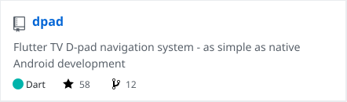
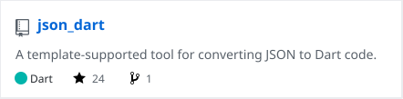
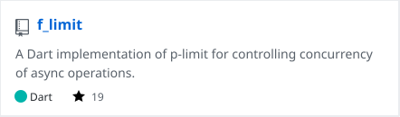
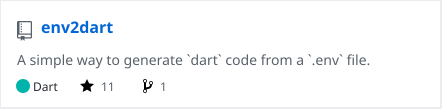
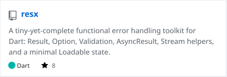
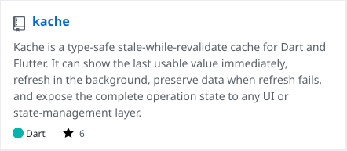

# 🚀 iota9star — building the whole stack, one iota at a time

**Full Stack Developer** 🧑‍💻 · **Rust & Java Backend** 🦀☕ · **Product Mindset** 🎯

From Rust services that never blink under load to Flutter apps that feel at home on phones and TVs — I ship software that respects both the machine and the person using it ⚡

## 👨‍💻 About Me

Hi, I'm **iota9star** — named after the smallest unit of change, because that's exactly how good software gets made: one deliberate commit at a time ✨
I move up and down the stack without an elevator 🛗: Rust (Axum) and Java (Spring) backends that hold their latency when traffic spikes, Flutter clients that feel native whether you're tapping a phone or steering a TV remote 📺, and React / Vue frontends that get out of the user's way
My definition of a great backend is a boring one — predictable, observable, quietly fast 🧱 My definition of a great frontend is an invisible one — people remember their task got done, not your animations 🪄
Off the clock you'll find me wiring AI agents into real dev workflows 🤖, tracing value flows across BTC / EVM / IC ⛓️, hunting this season's bangumi 🌸, or shipping yet another Flutter package with the [fluttercandies](https://github.com/fluttercandies) crew 🍬

## 🎯 What I Do

- 🦀 **High-performance backends** — Rust + Axum and Java + Spring microservices that fail gracefully and scale loudly
- 📱 **Cross-platform clients** — Flutter for mobile and TV, React / Vue for the web, Kotlin for native Android
- 🤖 **AI-native development** — code assistants, agent pipelines, and quality gates wired into everyday engineering
- ⛓️ **Web3 engineering** — BTC, EVM, and the Internet Computer, from wallet to wire
- 🍬 **Open source maintenance** — 20 Flutter packages under the [fluttercandies](https://github.com/fluttercandies) umbrella

## 🛠️ Tech Stack

**🦀 Languages**  
    

**⚙️ Backend**  
   

**🎨 Frontend**  
   

**🤖 AI & ⛓️ Web3**  
🤖 Agents & assistants · 🧠 Quality-first AI workflows ·   

## 📊 Quick Stats

- ⭐ **1.8K+ stars** across the 24 featured repositories below — 1,829 and counting
- 🌸 **[mikan_flutter](https://github.com/iota9star/mikan_flutter)** is the flagship at **1,392 ⭐**
- 🦀 **[fjs](https://github.com/fluttercandies/fjs)** is the fastest climber — **115 ⭐** and rising
- 📺 **[dpad](https://github.com/fluttercandies/dpad)** puts Flutter on the big screen with **60 ⭐**
- 🍬 **20 packages** contributed to the [fluttercandies](https://github.com/fluttercandies) ecosystem
- 🔥 The 3D contribution skyline above grows with every commit — watch it tower

  
  

## 🔥 Featured Projects

**1.8K+ ⭐ across 24 projects — sorted by popularity, every card clickable 👇**

<table>
<tr>
<td align="center"></td>
<td align="center"></td>
</tr>
<tr>
<td align="center"></td>
<td align="center"></td>
</tr>
<tr>
<td align="center"></td>
<td align="center"></td>
</tr>
<tr>
<td align="center"></td>
<td align="center"></td>
</tr>
<tr>
<td align="center"></td>
<td align="center"></td>
</tr>
<tr>
<td align="center"></td>
<td align="center"></td>
</tr>
<tr>
<td align="center"></td>
<td align="center"></td>
</tr>
<tr>
<td align="center"></td>
<td align="center"></td>
</tr>
<tr>
<td align="center"></td>
<td align="center"></td>
</tr>
<tr>
<td align="center"></td>
<td align="center"></td>
</tr>
<tr>
<td align="center"></td>
<td align="center"></td>
</tr>
<tr>
<td align="center"></td>
<td align="center"></td>
</tr>
</table>

## 🏆 Highlights

- 🌸 **[mikan_flutter](https://github.com/iota9star/mikan_flutter)** — Flutter client for the Mikan Project: bangumi tracking, RSS subscriptions, and a UI its 1,392 stargazers clearly enjoy
- 🦀 **[fluttercandies/fjs](https://github.com/fluttercandies/fjs)** — a JavaScript runtime embedded in Flutter via Rust and QuickJS: hot code, native shell (115 ⭐)
- 📺 **[fluttercandies/dpad](https://github.com/fluttercandies/dpad)** — directional-pad focus navigation that makes Flutter TV apps feel first-class (60 ⭐)
- 🍬 **fluttercandies core contributor** — caching ([kache](https://github.com/fluttercandies/kache)), rate limiting ([f_limit](https://github.com/fluttercandies/f_limit)), routing ([dash_router](https://github.com/fluttercandies/dash_router)), state ([hora](https://github.com/fluttercandies/hora)), config ([env2dart](https://github.com/fluttercandies/env2dart)) and 15 more
- 🌸 **Anime data tooling** — [sakura-dmhy](https://github.com/iota9star/sakura-dmhy) and [kisssub](https://github.com/iota9star/kisssub) keep resources flowing to the community
- ⛓️ **[void_signals](https://github.com/void-signals/void_signals)** — separating on-chain signal from noise, one metric at a time

## 💡 Quote of the Moment

> 🌅 *"你背朝太阳，就只能看到自己的影子。"*
> — *纪伯伦 (Kahlil Gibran)* · via [Hitokoto](https://hitokoto.cn)

*With your back to the sun, all you can see is your own shadow.* Face the light, then ship the code ☀️

## 💭 Philosophy

- ⚡ **Latency is a feature** — users feel every millisecond, so I count them
- 🧱 **Boring is beautiful** — explicit types, honest tests, zero clever traps
- 🪜 **Think in iotas** — small steps, compounded daily, become big systems ✨
- 🤖 **AI as a colleague** — delegate the toil, review like it's your own PR
- 🌱 **Learn in public** — every package shipped is a lesson shared

## 📧 Connect

- ✉️ Email: [iota9star@gmail.com](mailto:iota9star@gmail.com)
- 🐦 X: [@iota9star](https://x.com/iota9star)
- ⛏️ Juejin: [Blog](https://juejin.cn/user/1591748568562829)
- 🐙 GitHub: [@iota9star](https://github.com/iota9star)

Thanks for scrolling this far — may your builds be green, your pagers silent, and your stars bright 🌟
