### 👨‍💻 About Me

Hi, I'm **iota9star** 🌟 — a full stack developer who treats the entire stack as one canvas 🎨  
By day I'm shaping ☕ Java microservices and 🦀 Rust services that stay fast under pressure; by night I'm polishing 📱 Flutter animations until they feel inevitable, or sketching reactive state graphs ⚡ on the whiteboard.  
I care about the details users never name but always feel: honest error messages 🧯, empty states with personality 🫧, and latency you can't perceive ✨  
When I'm not shipping, I'm publishing open source candy 🍬 under [fluttercandies](https://github.com/fluttercandies), mentoring AI agents 🤖 to write code humans enjoy reviewing, and exploring the Web3 frontier ⛓️

### 🎯 What I Do

- 🦀 **High-Performance Backends** — Rust (Axum) and Java (Spring) services engineered for throughput, resilience, and observability
- 📱 **Cross-Platform Products** — Flutter, React, Vue & Android experiences that feel at home on every screen
- 🍬 **Open Source Packaging** — 20+ Flutter packages authored and maintained for the community
- 🤖 **AI-Native Development** — assistants and agents woven into workflows with a quality-first bar
- ⚡ **Reactive Systems R&D** — fine-grained signals and state graphs with zero-boilerplate ergonomics
- ⛓️ **Web3 Exploration** — BTC fundamentals, EVM contracts, and Internet Computer canisters

### 🛠️ Tech Stack

**💻 Languages**  
    

**⚙️ Backend**  
   

**🎨 Frontend**  
   

**🤖 AI & ⛓️ Web3**  
    

### 📊 Quick Stats

    

  

### 🔥 Featured Projects

🌟 Ranked by community love — tap any card to explore the source 🔍

[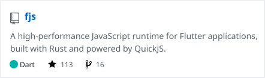](https://github.com/fluttercandies/fjs)
[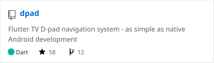](https://github.com/fluttercandies/dpad)

[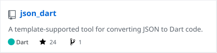](https://github.com/fluttercandies/json_dart)
[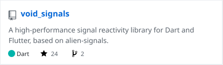](https://github.com/void-signals/void_signals)
[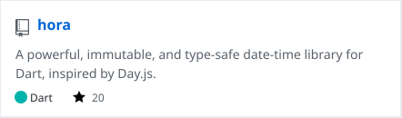](https://github.com/fluttercandies/hora)
[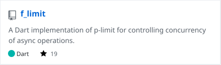](https://github.com/fluttercandies/f_limit)
[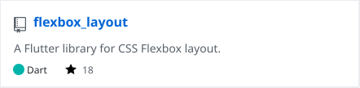](https://github.com/fluttercandies/flexbox_layout)
[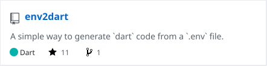](https://github.com/fluttercandies/env2dart)
[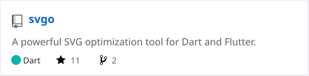](https://github.com/fluttercandies/svgo)
[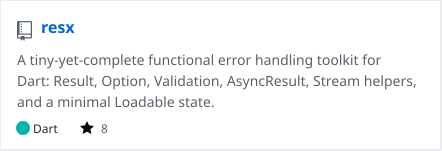](https://github.com/fluttercandies/resx)
[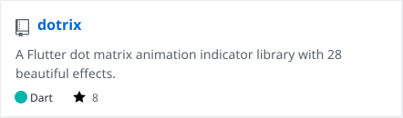](https://github.com/fluttercandies/dotrix)

[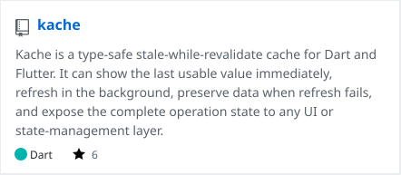](https://github.com/fluttercandies/kache)
[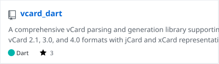](https://github.com/fluttercandies/vcard_dart)

### 🏆 Highlights

- 🥇 [mikan_flutter](https://github.com/iota9star/mikan_flutter) — **1.37k ⭐** a Bangumi & anime tracking client the community asked for, by name
- 🦀 [fjs](https://github.com/fluttercandies/fjs) — **114 ⭐** a Rust-powered JavaScript runtime so Flutter can run JS at native speed
- 🍬 **20+ packages** under the [fluttercandies](https://github.com/fluttercandies) umbrella — JSON, routing, layouts, concurrency limits, caching, images, and more
- ⚡ [void_signals](https://github.com/void-signals/void_signals) — fine-grained reactive signals for Dart, designed from first principles
- 🧭 Rustacean by conviction, Java craftsman by trade, product person by instinct
- 🤝 Open source citizen — reviews, docs, and examples given back across ecosystems

### 💭 Philosophy

- 🎯 Build the product, not just the code — the experience is the destination
- 🧱 Small commits, honest reviews, zero broken windows
- 🤖 Automate the boring, handcraft the essential
- 🌱 Leave every codebase easier to understand than you found it
- 📚 Stay curious — today's weekend hack becomes tomorrow's production stack ✨

### 💡 Quote of the Moment

> 「开成花灾的玫瑰不是灿烂，而是荒凉。」  
> *"Roses that bloom into a flood of blossoms make not brilliance, but desolation."*  
> — 严歌苓《花儿与少年》· via hitokoto 🌹

### 🌍 Contribution Landscape

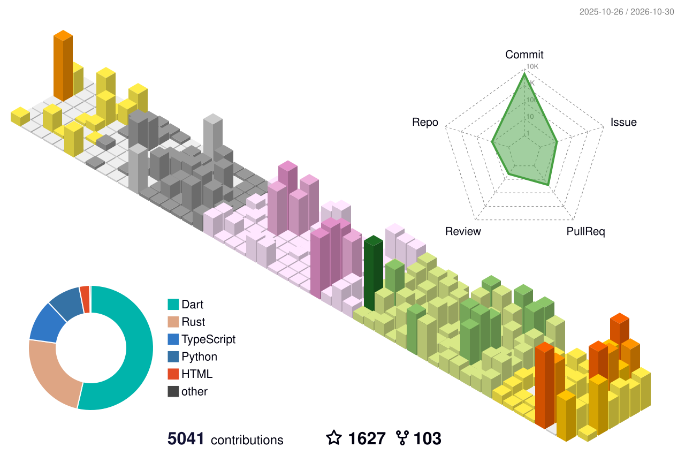

### 📧 Connect with Me

  

⭐️ From [iota9star](https://github.com/iota9star)
