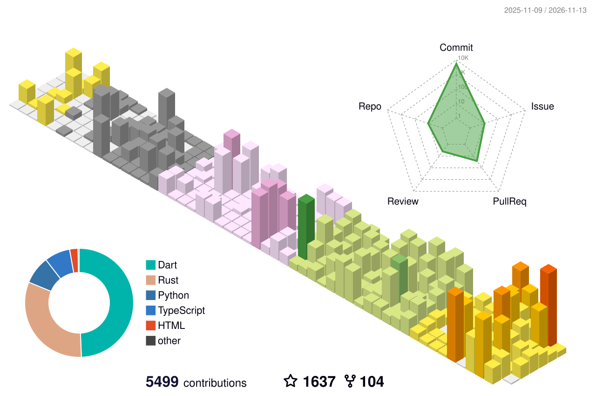

# Hi, I'm iota9star 👋

**Full Stack Developer | Rust & Java Backend | Product Mindset** ✨

## 👨‍💻 About Me

Hi, I'm **iota9star** — I build digital experiences across the whole stack, from high-performance backends to interfaces people genuinely enjoy touching.
On the server I lean on **Rust** 🦀 and **Java** ☕ for speed and reliability; on the client I reach for **Flutter** 📱, **React**, and **Vue** to make that speed feel effortless.
I treat product thinking as an engineering skill rather than a department — the best code is the code that ships the right thing. 🎯
These days I'm fusing **Rust into the Flutter ecosystem** ⚡, shipping open-source packages with the **fluttercandies** org 🍬, and weaving **AI agents** 🤖 into my everyday workflow.
Off the clock you'll find me tracking seasonal anime 🎬, wandering Bitcoin and EVM rabbit holes ⛓️, and rewriting things that already worked — just faster.

## 🎯 What I Do

- 🦀 **Systems-grade backends** — Axum and Spring services that stay fast under pressure
- 📱 **Cross-platform clients** — Flutter, Android, React, and Vue apps with real polish
- 🤖 **AI-powered engineering** — code assistants, agent workflows, and quality-first automation
- ⛓️ **Web3 exploration** — BTC, EVM, and the Internet Computer
- 🧩 **Open source** — maintaining 20+ Dart/Flutter packages in the fluttercandies ecosystem

## 🛠️ Tech Stack

**Languages**
    

**Backend**
   

**Frontend**
   

**Also exploring**
🤖 AI agents · ⛓️ BTC / EVM / IC · ✅ quality-focused workflows · 🌸 anime APIs & scrapers

## 📊 Quick Stats

⭐ **1.8K+ stars** across featured repos · 📦 **24 projects** below · 🥇 top repo **1.4K+ ⭐** · 🦀 Rust × Dart is my favorite crossover episode

## 🔥 Featured Projects

<table>
<tr>
<td align="center"></td>
<td align="center"></td>
</tr><tr>
<td align="center"></td>
<td align="center"></td>
</tr><tr>
<td align="center"></td>
<td align="center"></td>
</tr><tr>
<td align="center"></td>
<td align="center"></td>
</tr><tr>
<td align="center"></td>
<td align="center"></td>
</tr><tr>
<td align="center"></td>
<td align="center"></td>
</tr><tr>
<td align="center"></td>
<td align="center"></td>
</tr><tr>
<td align="center"></td>
<td align="center"></td>
</tr><tr>
<td align="center"></td>
<td align="center"></td>
</tr><tr>
<td align="center"></td>
<td align="center"></td>
</tr><tr>
<td align="center"></td>
<td align="center"></td>
</tr><tr>
<td align="center"></td>
<td align="center"></td>
</tr>
</table>

## 🏆 Highlights

- 🌟 **mikan_flutter** — 1.4K+ ⭐ Mikan Project client; the anime-bangumi companion the community actually uses
- ⚡ **fjs** — a JavaScript runtime for Flutter built with Rust on QuickJS: two worlds, one runtime
- 📺 **dpad** — TV D-pad navigation for Flutter, as simple as native Android development
- 🍬 **fluttercandies** — contributor across 20+ ecosystem packages: routing 🧭, caching 💾, layout 📐, parsing 🔍
- 🌸 **sakura-dmhy & kisssub** — resource clients in Java and Kotlin sharing one product philosophy
- 🕸️ **void_signals** — high-performance signal reactivity for Dart, based on alien-signals
- 🤖 **goal & toto** — AI-first CLI tools: idempotent goal tracking 🔁 and deterministic TOTP/HOTP 🔐

## 💭 Philosophy

> Ship things that respect the user's time ⏱️, write code that respects the next reader 📖, and treat performance as a feature — never an afterthought. 🚀

## 💡 Quote of the Moment

> 这世界如此寂静，是因为我一直在等你的声音。
> *"The world is so quiet, because I have been waiting for the sound of your voice."*
> — 《我有一座恐怖屋》, 我会修空调 📚

## 📧 Connect

- 📮 Email: [iota9star](mailto:iota9star@gmail.com)
- 🐦 X: [@iota9star](https://x.com/iota9star)
- ✍️ Juejin: [Blog](https://juejin.cn/user/1591748568562829)

